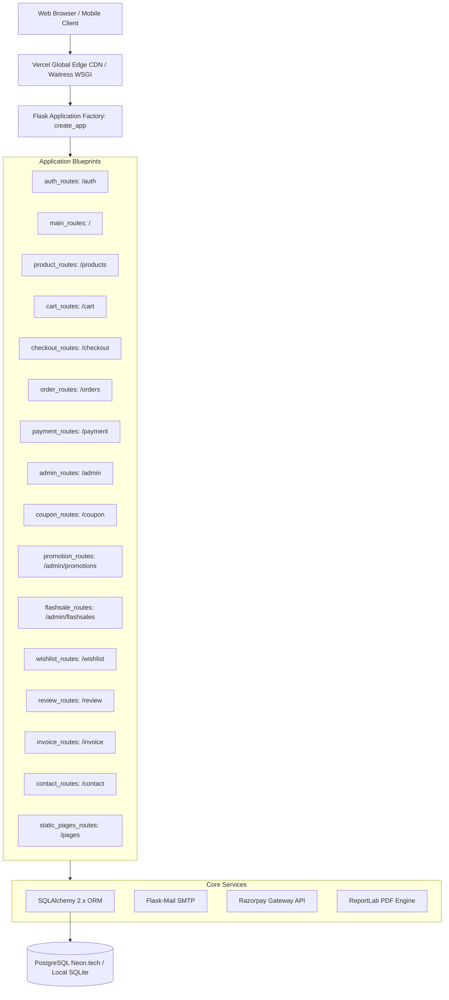

<div align="center">

# ⚡ SportsHub — Premium Sports E-Commerce Platform

[](https://python.org)
[](https://flask.palletsprojects.com/)
[](https://www.sqlalchemy.org/)
[](https://neon.tech)
[](https://razorpay.com)
[](https://www.reportlab.com/)
[](https://vercel.com)
[](LICENSE)

**SportsHub** is a production-grade, full-stack e-commerce web platform engineered for sports gear, athletic equipment, and fitness accessories. Built with clean Flask Application Factory architecture, dual-database flexibility (local SQLite & cloud serverless Neon PostgreSQL), secure Razorpay payments, real-time Chart.js admin analytics, automated transactional emails, and serverless edge deployment on Vercel.

[Key Features](#-key-features) • [Architecture](#-application-architecture) • [Quick Start](#-quick-start--local-setup) • [Database](#-database-schema--seeding) • [Admin Suite](#-admin-management-suite) • [Deployment](#-cloud-deployment-guide)

---

</div>

## 🌟 Key Features

### 🛍️ Customer Experience & Storefront
- **Dynamic Catalog Browsing:** Browse products across major categories: *Football, Cricket, Basketball, Badminton, Running, Gym & Fitness, Tennis*.
- **Multi-parameter Filtering & Search:** Real-time keyword search across names/descriptions, category filtering with live product counts, price range filtering (min/max), and stock availability filters.
- **Dynamic Sorting:** Sort items by price (ascending/descending) or newest releases with pagination (9 items/page).
- **Product Detail Showcase:** High-resolution product showcase with zoom preview, live stock badges (In Stock, Low Stock alert `<5`, Out of Stock), effective price calculation, and related items carousel.
- **Verified Reviews & Ratings:** 5-star customer rating system with athlete badge, review submission, edit, and deletion capabilities.
- **Customer Wishlist:** Save items for later with 1-click wishlist add/remove and navbar badge counter.

### 💰 Pricing, Discounts & Promotions Engine
- **Flash Sales Engine:** Time-bound flash discounts on individual products with live badge indicators and automated expiration.
- **Tiered Coupon Codes:** Percentage-based and fixed-amount coupon codes (e.g. `WELCOME10`, `SPORT500`) with minimum purchase thresholds, maximum discount caps, usage limits, and expiration dates.
- **Cart-level Promotions:** Automated campaigns targeting specific categories or whole carts.
- **Dynamic Price Engine:** Intelligent priority-based calculation ensures customers always get the single best discount between flash sales, promotions, and coupons.

### 🛒 Cart, Checkout & Payment Gateway
- **Interactive Shopping Cart:** Real-time quantity adjustments, automatic out-of-stock prevention, and persistent database storage per user.
- **Free Delivery Progress Indicator:** Live progress bar calculating gap to free delivery (`₹999` threshold).
- **GST Compliance:** Automated 18% GST calculation, taxable amount separation, and transparent itemized breakdown.
- **Dual Payment Options:**
  1. **Razorpay Test Mode:** 256-bit SSL encrypted online payment gateway supporting Cards, UPI, NetBanking, and Wallets with cryptographic HMAC SHA256 signature verification.
  2. **Cash on Delivery (COD):** Seamless offline order placement with automatic inventory reduction.

### 📦 Order Tracking & Automated Invoices
- **Order Status Lifecycle:** Detailed state transitions (`Placed` → `Confirmed` → `Packed` → `Shipped` → `Out for Delivery` → `Delivered` / `Cancelled`).
- **Interactive Timeline:** Step-by-step audit history tracking status updates with timestamps and admin remarks.
- **Automated PDF Invoices:** Built-in PDF invoice generation powered by **ReportLab**, complete with corporate branding, GST registration numbers, billing address, and itemized financials downloadable in 1 click.

### 📧 Transactional Email Notifications
- **Automated Alerts via Flask-Mail:** HTML emails for user registration, password changes, order confirmations, status transitions, and contact form acknowledgments.
- **Resilient Fallback:** Graceful exception handling ensures orders complete smoothly even if SMTP credentials are not configured.

---

## 🏗️ Application Architecture

SportsHub uses the **Flask Application Factory** pattern, separating routing, business logic, templates, and data access into 17 specialized Blueprints:



---

## 🛠️ Technology Stack

| Domain | Technology | Description |
| :--- | :--- | :--- |
| **Backend Framework** | **Flask 3.1.3** | Lightweight WSGI Python microframework with application factory |
| **Language** | **Python 3.11+ / 3.12 / 3.13** | Typed, modern Python runtime |
| **ORM & DB Layer** | **SQLAlchemy 2.0.51** | Enterprise object-relational mapping and schema design |
| **Database Migrations**| **Flask-Migrate (Alembic 1.18)** | Declarative database migrations |
| **Database (Local)** | **SQLite 3** | Zero-configuration file-based storage (`instance/sportshub.db`) |
| **Database (Cloud)** | **PostgreSQL (Neon / Supabase)** | Serverless cloud PostgreSQL with SSL encryption |
| **User Authentication** | **Flask-Login 0.6.3** | Session handling, user loaders, and route authorization guards |
| **Password Security** | **Werkzeug 3.1.8** | Modern password hashing (`generate_password_hash` / `check_password_hash`) |
| **Forms & CSRF** | **Flask-WTF 1.3.0 & WTForms 3.2** | CSRF protection, input sanitation, and form validation |
| **Payment Gateway** | **Razorpay Python SDK 2.0.1** | Order creation, payment modal handling, signature verification |
| **PDF Generation** | **ReportLab 5.0.0** | Programmatic commercial PDF invoice compilation |
| **Email Delivery** | **Flask-Mail 0.10.0** | Transactional email generation via SMTP (Gmail App Password support) |
| **Production WSGI** | **Waitress 3.0.2 / Gunicorn 23.0** | Production WSGI application servers |
| **Serverless Deployment** | **@vercel/python** | Serverless function deployment via `vercel.json` and `api/index.py` |
| **UI & Styling** | **Vanilla CSS + Bootstrap 5.3.3** | Glassmorphism, tailored dark theme, Google Fonts (Inter & Outfit) |
| **Data Analytics** | **Chart.js 4.4** | Interactive charts for sales, orders, and category breakdowns |

---

## 📂 Project Directory Structure

```text
Sports_hub/
├── api/
│   └── index.py                # Serverless WSGI entry point for Vercel deployment
├── app/
│   ├── __init__.py             # Application factory (create_app) & extension init
│   ├── config.py               # Dual database config (SQLite vs. Neon PostgreSQL)
│   ├── forms.py                # WTForms definitions (Register, Login, Reviews, etc.)
│   ├── models.py               # 15 SQLAlchemy database models and enumerations
│   ├── helpers/
│   │   ├── discount_helper.py  # Pricing, flash sales, and multi-tier discount math
│   │   ├── email_helper.py     # Transactional email sender with template rendering
│   │   └── invoice_helper.py   # High-resolution ReportLab PDF invoice generator
│   └── routes/                 # 17 Blueprint modules
│       ├── admin_routes.py     # Admin dashboard, analytics, inventory, and order control
│       ├── auth_routes.py      # Login, registration, and logout flows
│       ├── cart_routes.py      # Shopping cart operations (add, remove, update)
│       ├── checkout_routes.py  # Checkout form, GST calculation, and order placing
│       ├── contact_routes.py   # Customer inquiry submissions and confirmations
│       ├── coupon_routes.py    # Coupon application, validation, and admin CRUD
│       ├── flashsale_routes.py # Flash sales management and scheduling
│       ├── inventory_routes.py # Inventory routes and redirects
│       ├── invoice_routes.py   # PDF invoice download endpoint
│       ├── main_routes.py      # Homepage, user dashboard, and profile management
│       ├── order_routes.py     # User order history, details, and order cancellation
│       ├── payment_routes.py   # Razorpay signature verification and failure fallback
│       ├── product_routes.py   # Catalog filters, search, pagination, and details
│       ├── promotion_routes.py # Promotional campaign management and reports
│       ├── review_routes.py    # Customer review submissions, edits, and deletions
│       ├── static_pages_routes.py # About Us and FAQ pages
│       └── wishlist_routes.py  # User wishlist management
├── docs/
│   ├── database_design.md      # Comprehensive data dictionary and ERD documentation
│   └── vercel_deployment.md    # Step-by-step Vercel + Neon setup guide
├── instance/                   # Local SQLite storage directory
├── migrations/                 # Alembic database migration scripts
├── static/
│   └── css/
│       └── style.css           # Premium glassmorphic dark design stylesheet
├── templates/                  # 49 Jinja2 HTML templates
│   ├── base.html               # Master layout with announcement bar & responsive navbar
│   ├── index.html              # Homepage with hero, flash sales, bestsellers, and trust badges
│   ├── products.html           # Catalog page with filter sidebar and pagination
│   ├── product_detail.html     # Single product page with review submission & wishlist
│   ├── cart.html               # Cart with live shipping bar and coupon field
│   ├── checkout.html           # Checkout page with dual payment selection
│   ├── payment.html            # Razorpay checkout modal launcher
│   ├── admin_dashboard.html    # Admin panel with Chart.js analytics & quick actions
│   ├── admin_products.html     # Product catalog CRUD management
│   ├── admin_inventory.html    # Stock threshold monitor & bulk stock editor
│   ├── admin_orders.html       # Order status tracking & filter controls
│   ├── admin_coupons.html      # Coupon management table
│   ├── admin_promotions.html   # Promotions manager
│   ├── admin_flashsales.html   # Flash sales scheduler
│   └── emails/                 # 11 Transactional HTML email templates
├── .env.example                # Template for environment configuration
├── requirements.txt            # Complete production and development dependencies
├── requirements-prod.txt       # Clean dependencies for serverless/PaaS
├── run.py                      # Local development entry point
├── seed_db.py                  # One-click instant database populator
└── vercel.json                 # Vercel serverless routing configuration
```

---

## 🚀 Quick Start & Local Setup

### 1. Prerequisites
- **Python:** 3.10, 3.11, 3.12, or 3.13 installed
- **Git:** Installed on your machine

### 2. Clone the Repository
```bash
git clone https://github.com/nikhilghotankar-8881/SportsHub.git
cd SportsHub
```

### 3. Create & Activate Virtual Environment
```bash
# Windows (PowerShell)
python -m venv venv
.\venv\Scripts\Activate.ps1

# Windows (Command Prompt)
venv\Scripts\activate.bat

# macOS / Linux
python3 -m venv venv
source venv/bin/activate
```

### 4. Install Dependencies
```bash
pip install -r requirements.txt
```

### 5. Configure Environment Variables
Copy `.env.example` to `.env`:
```bash
# Windows
copy .env.example .env

# macOS / Linux
cp .env.example .env
```
*(If left blank, SportsHub will automatically default to local SQLite and mock payment credentials for seamless offline testing).*

### 6. Seed the Database
Initialize all tables and populate with default admin, test athlete, sports products, coupons, and flash sales in one step:
```bash
python seed_db.py
```

### 7. Run the Application
```bash
python run.py
```
Open your browser and navigate to: **[http://127.0.0.1:5000](http://127.0.0.1:5000)**

---

## 🔐 Default Demo Accounts

| Account Role | Email Address | Password | Permissions |
| :--- | :--- | :--- | :--- |
| **Store Administrator** | `admin@sportshub.com` | `Admin@12345` | Full administrative control, inventory, analytics, order management |
| **Demo Customer** | `athlete@sportshub.com` | `User@12345` | Standard customer account with sample reviews and order history |

---

## ⚙️ Environment Variables Reference

| Variable | Required? | Default / Example | Purpose |
| :--- | :--- | :--- | :--- |
| `SECRET_KEY` | Recommended | `sportshub-production-secret-key-32-chars-long` | Session encryption and CSRF signing |
| `DATABASE_URL` | Optional | `sqlite:///instance/sportshub.db` | PostgreSQL connection string (Neon / Render) |
| `RAZORPAY_KEY_ID` | Optional | `rzp_test_TEocfg67ysVCVM` | Razorpay Test API Key |
| `RAZORPAY_KEY_SECRET` | Optional | `cBrjWcQlgex31RvAF4I2DAS0` | Razorpay Test Secret Key |
| `MAIL_SERVER` | Optional | `smtp.gmail.com` | SMTP Server Host |
| `MAIL_PORT` | Optional | `587` | SMTP Port (587 for TLS) |
| `MAIL_USE_TLS` | Optional | `true` | Enable TLS encryption |
| `MAIL_USERNAME` | Optional | `your-email@gmail.com` | Gmail sender address |
| `MAIL_PASSWORD` | Optional | `xxxx xxxx xxxx xxxx` | 16-character Google App Password |
| `MAIL_DEFAULT_SENDER` | Optional | `your-email@gmail.com` | From header address on outgoing emails |
| `GST_RATE` | Optional | `18` | Goods and Services Tax percentage |
| `FREE_DELIVERY_ABOVE`| Optional | `999` | Minimum cart subtotal for free delivery (₹) |
| `DELIVERY_CHARGE` | Optional | `49` | Flat delivery fee on orders below threshold (₹) |

---

## 🗄️ Database Schema & Seeding

SportsHub incorporates 15 specialized models:
1. **`User`**: Account identity, passwords, admin privileges.
2. **`Product`**: Catalog, stock counts, low stock thresholds, and categories.
3. **`CartItem`**: User-specific shopping cart rows with unique constraints.
4. **`Order`**: Purchase snapshots, shipping destination, GST amount, and coupon history.
5. **`OrderItem`**: Historical purchase line items and unit pricing.
6. **`OrderStatusHistory`**: Status lifecycle log with audit timestamps.
7. **`Payment`**: Razorpay transaction identifiers, payment status, and COD tracking.
8. **`Coupon`**: Percentage and fixed discount codes with caps and limits.
9. **`Promotion`**: Marketing campaigns with customizable date windows.
10. **`PromotionProduct`**: Links promotions to specific catalog items.
11. **`PromotionCategory`**: Restricts promotional campaigns to sports categories.
12. **`FlashSale`**: Limited-time product sales with countdown timers.
13. **`Wishlist`**: Product bookmarks for authenticated customers.
14. **`Review`**: 1 to 5 star verified buyer reviews and comments.
15. **`Contact`**: Customer inquiry messages with read status tracking.

*For complete data dictionary and constraints, view [docs/database_design.md](docs/database_design.md).*

---

## 🛡️ Admin Management Suite

Accessible via `/admin/dashboard` when logged in as an administrator:
- **Real-Time Analytics:** 7-day sales line chart, order status distribution doughnut chart, total revenue metrics, and average order values.
- **Product Management (`/admin/products`):** Full CRUD catalog controls, image URL linking, and stock assignment.
- **Inventory Monitor (`/admin/inventory`):** Filter by low stock (`<=5`) or out of stock (`0`), with single-click inline and bulk inventory updates.
- **Order Processing (`/admin/orders`):** Filter by status, search by customer, update order statuses (`Packed`, `Shipped`, `Delivered`), and add tracking remarks.
- **Payment Auditing (`/admin/payments`):** Monitor live and COD transaction states, revenue tallies, and initiate refunds.
- **Coupons & Flash Sales (`/coupon/admin/list` & `/admin/flashsales/`):** Toggle active statuses, schedule flash sale windows, and inspect redemption counters.
- **Customer Messages (`/admin/contacts`):** Review user inquiries submitted via the Contact Us portal with unread badge alerts.

---

## ☁️ Cloud Deployment Guide

### Option 1: Deploying to Vercel (Serverless Edge)
SportsHub is fully pre-configured for **Vercel** serverless hosting:
1. Push your repository to GitHub.
2. Sign up for a free cloud PostgreSQL database on **[Neon.tech](https://neon.tech)** and copy your connection string.
3. In your local terminal, run `python seed_db.py` with `DATABASE_URL` set to your Neon URL to initialize cloud tables and products.
4. In the **Vercel Dashboard**, click **"Add New Project"** and import `SportsHub`.
5. Under **Environment Variables**, add `DATABASE_URL`, `SECRET_KEY`, and Razorpay keys.
6. Click **Deploy**. Vercel compiles the serverless lambda via [`api/index.py`](api/index.py) and caches all static assets globally.

*For detailed Vercel instructions, see [docs/vercel_deployment.md](docs/vercel_deployment.md).*

### Option 2: Deploying to Render
1. Create a new **PostgreSQL** instance on Render.
2. Create a new **Web Service** linked to your repository:
   - **Build Command:** `pip install -r requirements.txt && python seed_db.py`
   - **Start Command:** `gunicorn run:app`
3. Add environment variables under the Environment tab.

---

## 🧪 Testing & Verification

Run the built-in test suite to verify that all 69 routes, blueprints, and forms are executing with `200 OK`:
```bash
python -c "
import os; os.environ['DATABASE_URL'] = 'sqlite:///:memory:'
from app import create_app, db
app = create_app(); app.config['TESTING'] = True
with app.app_context(): db.create_all()
client = app.test_client()
for r in ['/', '/products', '/pages/about', '/pages/faq', '/contact/']:
    res = client.get(r)
    print(f'{r:20} -> {res.status_code}')
"
```

---

## 📄 License

This project is open-source and available under the **[MIT License](LICENSE)**.

---

<div align="center">
  Crafted with ❤️ by <a href="https://github.com/nikhilghotankar-8881"><strong>Nikhil Ghotankar</strong></a>
</div>