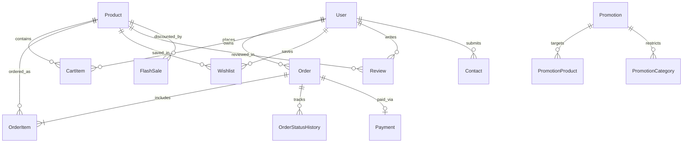

# 🗄️ SportsHub — Comprehensive Database Design & Schema Specification

## 1. Architectural Overview

SportsHub uses **SQLAlchemy 2.x** with the **Application Factory** pattern. The application seamlessly supports dual database engines:
- **Local Development:** SQLite (`instance/sportshub.db`) with automatic table initialization.
- **Production:** PostgreSQL (Cloud serverless hosted on **Neon.tech**, **Supabase**, or **Render**) with connection pooling and SSL encryption (`sslmode=require`).

---

## 2. Entity Relationship Diagram (ERD)

---

## 3. Data Dictionary & Table Schemas

### 3.1 `users`
Stores registered customers and store administrators.

| Column | Type | Constraints | Description |
| :--- | :--- | :--- | :--- |
| `id` | Integer | Primary Key, Auto-increment | Unique user identifier |
| `name` | String(100) | NOT NULL | Full name of the user |
| `email` | String(120) | NOT NULL, Unique, Indexed | Login email address |
| `password_hash` | String(255) | NOT NULL | Werkzeug scrypt/pbkdf2 hash |
| `is_admin` | Boolean | NOT NULL, Default: `False` | Admin privileges flag |
| `created_at` | DateTime | NOT NULL, Default: UTC | Account creation timestamp |

---

### 3.2 `products`
The core sports gear and athletic equipment catalog.

| Column | Type | Constraints | Description |
| :--- | :--- | :--- | :--- |
| `id` | Integer | Primary Key, Auto-increment | Unique product ID |
| `name` | String(200) | NOT NULL, Indexed | Equipment/Product title |
| `category` | String(100) | Nullable, Indexed | Category (Football, Cricket, etc.) |
| `price` | Numeric(12, 2) | NOT NULL | Regular selling price (₹) |
| `stock` | Integer | NOT NULL, Default: 0 | Available physical inventory |
| `low_stock_threshold` | Integer | NOT NULL, Default: 5 | Alert threshold for low inventory |
| `image` | String(500) | Nullable | Unsplash CDN URL or local static path |
| `description` | Text | Nullable | Full markdown/HTML product overview |
| `created_at` | DateTime | NOT NULL, Default: UTC | Product cataloging timestamp |

---

### 3.3 `cart_items`
Persistent shopping cart for authenticated users.

| Column | Type | Constraints | Description |
| :--- | :--- | :--- | :--- |
| `id` | Integer | Primary Key, Auto-increment | Unique cart item ID |
| `user_id` | Integer | Foreign Key → `users.id`, NOT NULL | Owner user ID |
| `product_id` | Integer | Foreign Key → `products.id`, NOT NULL | Target product ID |
| `quantity` | Integer | NOT NULL, Default: 1 | Quantity selected |

*Constraint:* `UniqueConstraint('user_id', 'product_id', name='uq_cart_user_product')`

---

### 3.4 `orders`
Snapshot of purchases with billing and delivery addresses.

| Column | Type | Constraints | Description |
| :--- | :--- | :--- | :--- |
| `id` | Integer | Primary Key, Auto-increment | Order reference ID |
| `user_id` | Integer | Foreign Key → `users.id`, NOT NULL | Buyer user ID |
| `status` | String(30) | NOT NULL, Default: `placed` | `OrderStatus` enum value |
| `total_amount` | Numeric(12, 2) | NOT NULL | Final payable amount (incl. GST) |
| `discount_amount` | Numeric(12, 2) | NOT NULL, Default: 0 | Total coupon/promotion discount |
| `coupon_code` | String(50) | Nullable | Applied coupon code string |
| `gst_amount` | Numeric(12, 2) | NOT NULL, Default: 0 | 18% GST portion |
| `shipping_name` | String(150) | NOT NULL | Recipient full name |
| `shipping_address` | String(300) | NOT NULL | Street / Delivery address |
| `shipping_city` | String(100) | NOT NULL | City name |
| `shipping_phone` | String(20) | NOT NULL | Contact phone number |
| `created_at` | DateTime | NOT NULL, Default: UTC | Order submission timestamp |
| `updated_at` | DateTime | NOT NULL, Default: UTC | Last modification timestamp |

---

### 3.5 `order_items`
Line items capturing product and historical purchase price.

| Column | Type | Constraints | Description |
| :--- | :--- | :--- | :--- |
| `id` | Integer | Primary Key, Auto-increment | Order line ID |
| `order_id` | Integer | Foreign Key → `orders.id`, NOT NULL | Parent order |
| `product_id` | Integer | Foreign Key → `products.id`, NOT NULL | Purchased product |
| `quantity` | Integer | NOT NULL, Default: 1 | Units ordered |
| `unit_price` | Numeric(12, 2) | NOT NULL | Effective price at time of purchase |

---

### 3.6 `order_status_history`
Audit trail of status changes with timestamps and optional notes.

| Column | Type | Constraints | Description |
| :--- | :--- | :--- | :--- |
| `id` | Integer | Primary Key, Auto-increment | History entry ID |
| `order_id` | Integer | Foreign Key → `orders.id`, NOT NULL | Target order |
| `status` | String(30) | NOT NULL | New status code |
| `note` | String(300) | Nullable | Admin remark / tracking update |
| `changed_at` | DateTime | NOT NULL, Default: UTC | Timestamp of state transition |

---

### 3.7 `payments`
Tracks Razorpay transactions and Cash on Delivery records.

| Column | Type | Constraints | Description |
| :--- | :--- | :--- | :--- |
| `id` | Integer | Primary Key, Auto-increment | Payment ID |
| `order_id` | Integer | Foreign Key → `orders.id`, NOT NULL | Linked order |
| `razorpay_order_id` | String(100) | Nullable, Indexed | Razorpay `order_...` ID |
| `razorpay_payment_id` | String(100) | Nullable, Indexed | Razorpay `pay_...` ID |
| `payment_signature` | String(255) | Nullable | Cryptographic HMAC SHA256 signature |
| `payment_method` | String(50) | NOT NULL | `Razorpay` or `Cash on Delivery` |
| `amount` | Numeric(12, 2) | NOT NULL | Payment amount |
| `currency` | String(10) | NOT NULL, Default: `INR` | Currency code |
| `payment_status` | String(30) | NOT NULL | `paid`, `pending`, `failed`, `refunded` |
| `created_at` | DateTime | NOT NULL, Default: UTC | Payment record timestamp |

---

### 3.8 `coupons`
Discount coupon codes with usage limits and expiry dates.

| Column | Type | Constraints | Description |
| :--- | :--- | :--- | :--- |
| `id` | Integer | Primary Key, Auto-increment | Coupon ID |
| `code` | String(50) | NOT NULL, Unique, Indexed | Promo code (e.g., `WELCOME10`) |
| `description` | String(200) | Nullable | Display explanation |
| `coupon_type` | String(20) | NOT NULL, Default: `percentage` | `percentage` or `fixed` |
| `discount_value` | Numeric(10, 2) | NOT NULL | % discount or flat ₹ value |
| `minimum_purchase` | Numeric(10, 2) | NOT NULL, Default: 0 | Min cart total needed |
| `max_discount` | Numeric(10, 2) | Nullable | Upper limit cap for percentage type |
| `usage_limit` | Integer | Nullable | Total redemption cap (`None` = unlimited) |
| `used_count` | Integer | NOT NULL, Default: 0 | Count of successful redemptions |
| `is_active` | Boolean | NOT NULL, Default: `True` | Active toggle |
| `expires_at` | DateTime | Nullable | Expiration timestamp |
| `created_at` | DateTime | NOT NULL, Default: UTC | Created date |

---

### 3.9 `promotions`, `promotion_products`, `promotion_categories`
Automated marketing campaigns with category or product coverage.

- **`promotions`**: `id`, `name`, `description`, `promo_type`, `discount_value`, `max_discount`, `start_date`, `end_date`, `usage_limit`, `used_count`, `is_active`, `created_at`
- **`promotion_products`**: Link table mapping `promotion_id` to `product_id`.
- **`promotion_categories`**: Link table mapping `promotion_id` to `category` name.

---

### 3.10 `flash_sales`
High-discount countdown sales tied to individual products.

| Column | Type | Constraints | Description |
| :--- | :--- | :--- | :--- |
| `id` | Integer | Primary Key, Auto-increment | Flash sale ID |
| `product_id` | Integer | Foreign Key → `products.id`, NOT NULL | Discounted product |
| `discount_value` | Numeric(10, 2) | NOT NULL | Discount percentage (e.g. 25.00) |
| `start_time` | DateTime | NOT NULL | Sale start time (UTC) |
| `end_time` | DateTime | NOT NULL | Sale end time (UTC) |
| `created_at` | DateTime | NOT NULL, Default: UTC | Creation timestamp |

---

### 3.11 `wishlists` & `reviews`
- **`wishlists`**: `id`, `user_id`, `product_id`, `created_at`. Unique per `(user_id, product_id)`.
- **`reviews`**: `id`, `user_id`, `product_id`, `rating` (1-5), `review_text`, `created_at`.

---

### 3.12 `contacts`
Customer inquiries and messages submitted through the Contact Us form.

| Column | Type | Constraints | Description |
| :--- | :--- | :--- | :--- |
| `id` | Integer | Primary Key, Auto-increment | Contact ID |
| `name` | String(100) | NOT NULL | Sender full name |
| `email` | String(120) | NOT NULL | Sender email |
| `subject` | String(200) | NOT NULL | Inquired subject |
| `message` | Text | NOT NULL | Inquiry message body |
| `is_read` | Boolean | NOT NULL, Default: `False` | Admin read indicator |
| `created_at` | DateTime | NOT NULL, Default: UTC | Timestamp received |
